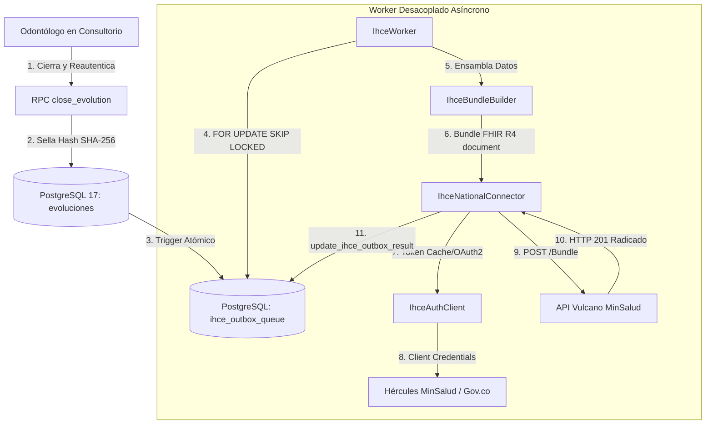

# 01. MANUAL TÉCNICO DE ARQUITECTURA IHCE — ODONTOCLOUD SAAS

**Versión:** 2.0  
**Fecha:** Octubre 2026  
**Normativa Base:** Ley 2015 de 2020, Resolución 866 de 2021, Resolución 1888 de 2025, Resolución 1799 de 2026 (MinSalud Colombia).

---

## 1. Visión General y Objetivos Arquitectónicos

El módulo de Interoperabilidad de la Historia Clínica Electrónica (IHCE) de OdontoCloud SaaS tiene como objetivo comunicar las atenciones clínicas odontológicas de consulta externa con el mecanismo nacional del Ministerio de Salud y Protección Social de Colombia (SISPRO / Mecanismo Central IHCE).

### Principios Fundamentales:
1. **Desacoplamiento Clínico vs. Operativo:** La atención odontológica en el consultorio nunca se bloquea por latencia o indisponibilidad de la red gubernamental. El sellado clínico es local e inmutable; el despacho ministerial es asíncrono.
2. **Transactional Outbox Pattern:** Toda evolución cerrada genera en la misma transacción de base de datos una tarea en la cola `ihce_outbox_queue`.
3. **Idempotencia Criptográfica:** Cada envío cuenta con un hash único derivado de `tenant_id:evolution_id:content_hash`, impidiendo radicaciones duplicadas.
4. **Principio de Menor Privilegio (Least Privilege) y Aislamiento Multi-Tenant:** Ni los superadministradores de infraestructura ni usuarios de clínicas vecinas pueden ver credenciales ni historiales clínicos ajenos.

---

## 2. Diagrama de Flujo y Componentes

---

## 3. Modelo de Datos de Interoperabilidad

### 3.1. `public.ihce_configurations`
- Almacena por clínica (`tenant_id`) los códigos oficiales REPS (12 dígitos), Sede (2 dígitos), ambiente (`SANDBOX_MOCK`, `PRUEBAS_MINSALUD`, `PRODUCCION`) y credenciales cifradas.
- Protegido por RLS estricto (`ihce_config_tenant_select`).

### 3.2. `public.ihce_outbox_queue`
- Registra el ciclo de vida del documento RDA: `PENDIENTE`, `PROCESANDO`, `ACEPTADO`, `RECHAZADO`, `ERROR_REINTENTO`, `ERROR_DEFINITIVO`.
- Columnas de concurrencia: `locked_by`, `locked_at` para soporte de múltiples instancias de worker sin colisiones.
- Trazabilidad: `radicado_oficial`, `response_fhir_id`, `ultimo_http_status`, `detalle_respuesta`.

### 3.3. `public.clinical_break_glass_sessions`
- Registro auditable de accesos excepcionales con límite de tiempo de 30 minutos y capacidad de revocación inmediata por el Administrador de la clínica.

---

## 4. Estándar HL7 FHIR R4 — Perfil de Documento RDA

El Bundle generado es de tipo `document` estricto conforme a la Guía Técnica MinSalud Colombia:
1. **Composition (Entrada 1):** Encabezado clínico obligatorio con código LOINC `11506-3` (Registro de consulta externa médica/odontológica).
2. **Patient:** Identificador con sistema oficial de cédula/documento, extensión `CoMunicipio` (DIVIPOLA) y extensión `CoPertenenciaEtnica` (DANE).
3. **Encounter:** Ámbito ambulatorio `AMB` y extensión `CoModalidadAtencion` (01 Intramural, etc.).
4. **Practitioner:** Identificación oficial y registro RETHUS.
5. **Organization & Location:** Razón social, NIT, código de prestador REPS y código de sede.
6. **Condition:** Diagnóstico principal y relacionados codificados en CIE-10 (alfanumérico de 3 o 4 caracteres).
7. **Procedure:** Procedimientos clínicos odontológicos codificados en CUPS (6 dígitos numéricos).
